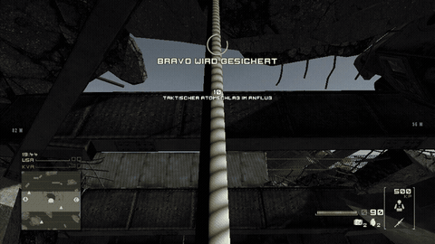
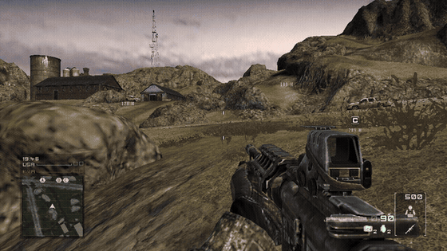
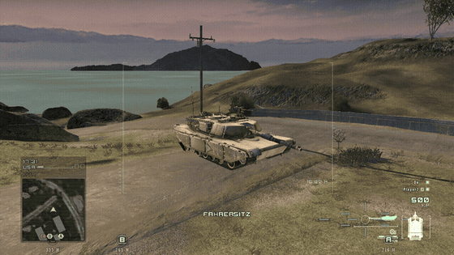
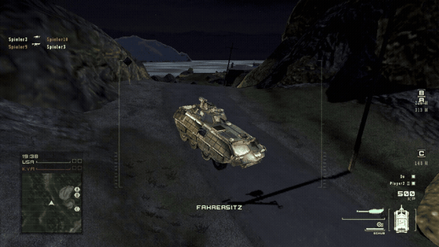
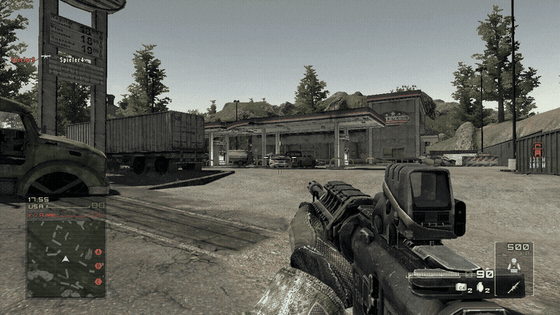
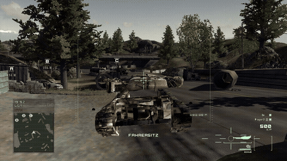

# HomeBots

**Homefront multiplayer – offline, with bots.**

HomeBots is a fan-made re-implementation of Homefront's (2011) multiplayer in Rust with the Bevy engine. HomeBots makes the multiplayer maps playable offline, against and together with AI soldiers. It reads the maps, models, textures, materials, sounds, menus and texts directly from your installed copy of **Homefront** (Steam) – similar to how OpenMW works for Morrowind. This repository and the release contain **no game files**; you need your own Homefront installation.



### What's in it

- **Ground Control and Team Deathmatch** on the multiplayer maps, with bots on both teams that capture objectives, use vehicles, throw grenades and only react to what they can actually see
- **Battle Points**: buy vehicles, drones and air strikes – the bots do it too
- **Vehicles**: tanks, LAVs, Humvees, Apache and scout helicopters, with damage, wrecks and fires
- **Drones and air strikes**: drones, Hellfire and bombing runs, used by players and bots
- **Weather and a day/night cycle**: rain and snow (not under roofs), thunderstorms, night lighting
- **End-of-match nuke**: shortly before a team wins the match, it gets a tactical nuke – Fulton pickup by a C-130, countdown, detonation, mushroom cloud and crater
- Original menus, HUD, kill feed, loading screens and the game's own post-processing (eye adaptation, bloom)

<p>


</p>
<p>


</p>
<p>

</p>

## Download and play

1. Get `HomeBots.zip` from the [Releases](../../releases) page and unpack it anywhere.
2. Double-click `HomeBots.exe`.

Homefront is expected at `C:\Program Files (x86)\Steam\steamapps\common\HOMEFRONT`. If it is installed elsewhere, put the path into `gamepath.txt` (one line without `#`) or set the environment variable `HOMEBOTS_GAME`.

The language follows Homefront's language setting in Steam (the GIFs above show the German version). Controls are the original game's (Options > Controls); F1 opens a debug menu.

## Build from source

Requires Rust (stable) on Windows.

```powershell
cd HomeBots
cargo run --release -p homebots
```

`tools\make_release.cmd` builds the release package into `dist\`.

## Crates

- `crates/upk` – reader for UE3 packages (`.u`, `.upk`, `.map`; Homefront's version 576/100, LZO chunks), textures, meshes, materials, shader cache
- `crates/upk-dump` – CLI that prints a package summary
- `crates/homebots` – the game (Bevy 0.16)

`MODLOG.md` is the (German) development log.

## Third-party content

The nuke sequence uses external models and sounds; see `assets/nuke/CREDITS.txt` (CC BY 4.0 / Pixabay Content License).

Homefront is a trademark of its respective owners. This is an unofficial fan project and is not affiliated with or endorsed by them.
